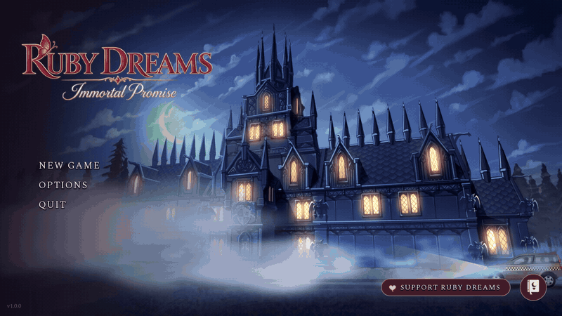

# Stablecoin for Games

**[Website](https://jrpg.com/stablecoinforgames/)** ·
[Docs](https://jrpg.com/stablecoinforgames/docs/) ·
[Releases](https://github.com/Repulse-Game-Studio/jrpg-stablecoin-games/releases/latest) ·
[itch.io](https://repulse-games.itch.io/stablecoin-for-games) ·
[npm](https://www.npmjs.com/package/stablecoin-games-renpy) ·
[PyPI](https://pypi.org/project/stablecoin-games-renpy/)

Accept **USDC/USDT tips and unlock purchases** in your game, paid straight to the developer's wallet, on
Ethereum, Arbitrum, Polygon, Base, **Arc** and **Solana**. No server, no accounts, no middleman in the payment:
the game watches the blockchain itself. One plugin per engine, for **Ren'Py, Godot, RPG Maker MZ, Unity and
Unreal Engine**, all with the same API shape, the same payment sheet and the same payment core.



## Engines

| Engine | You add | Status | Docs |
|---|---|---|---|
| **Ren'Py 8.2+** | `game/scfg/` and its Python core | Released: desktop and web builds | [Install](docs/developers/install.md) |
| **Godot 4.3+** | the `addons/scfg/` addon, pure GDScript | Preview: tested on 4.3 and 4.7.2, desktop and web exports | [Install](docs/developers/godot/install.md), [showcase](godot/showcase/README.md) |
| **RPG Maker MZ** | one plugin file, `js/plugins/SCFG.js` | Preview: tested on an in-repo MZ stand-in, **not yet in real RPG Maker MZ** | [Install](docs/developers/rpgmaker/install.md) |
| **Unity 6.3 LTS+** | the `com.repulse.scfg` UPM package (git URL or `.tgz`), C# | Preview: tested on 6000.6.9f1, Linux (Mono and IL2CPP) and WebGL players; 6.3 LTS, Windows and macOS not yet checked | [Install](docs/developers/unity/install.md), [samples](unity/Packages/com.repulse.scfg/Samples~/Showcase/README.md) |
| **Unreal Engine 5.6+** | the `Scfg` plugin (C++, Blueprint), UE 5.6+ | Preview: tested on UE 5.8.4, Linux desktop (uncooked and packaged); builds with MSVC on Windows, not yet fully tested there; 5.6/5.7, macOS and mobile not yet checked | [Install](docs/developers/unreal/install.md), [showcase](unreal/Plugins/ScfgShowcase/README.md) |

Mobile builds are best effort and unverified on every engine.

## What a game gets

- **Unlocks and tips.** Fixed-price items, pay-what-you-want items and a tip jar, in USDC or USDT.
- **Paid to your wallet.** The player sends the payment from their own wallet (a QR code, a browser-wallet
  checkout page, or a plain Send) to your address. Nothing passes through us or anyone else.
- **No server.** The game reads public RPC endpoints, finds the payment, verifies it and stores a receipt on the
  player's machine. Ownership checks (`owns("chapter2")`) are instant and work offline.
- **Restore.** A player who reinstalls or moves to another machine gets a purchase back from the chain with the
  payment's transaction hash.
- **Six networks built in**, plus any EVM chain you add: Ethereum, Arbitrum and Polygon (USDC and USDT), Base
  (USDC), Arc (USDC) and Solana (USDC and USDT). Testnets for all of them behind one switch.
- **A buy link for players with no stablecoin** (new in 0.3.0, see [below](#the-buy-link)).
- **Your look.** A logo and an accent colour in every engine, and deeper restyling in each engine's own way (see
  its docs). The texts can be reworded or translated in Godot and RPG Maker MZ; the screens are English only in Unity
  and Unreal for now.
- **Without code where the engine allows it:** RPG Maker's plugin parameters and commands, Unity's **SCFG
  Settings** asset, Unreal's **Project Settings > Plugins > SCFG** and Blueprint nodes.

Read [Security and limitations](docs/developers/security/README.md) before selling anything: without a server,
unlocks are honour-grade, and a determined player can bypass them.

## Install and first payment

Every release carries all the packages: download yours from the
[latest release](https://github.com/Repulse-Game-Studio/jrpg-stablecoin-games/releases/latest). Each snippet below
sets a wallet, adds one item and sells it on testnets, so no real money moves.

### Ren'Py

From your project folder: `uvx stablecoin-games-renpy install .` (or `pipx run stablecoin-games-renpy install .`,
or `npx stablecoin-games-renpy install .`), and `uvx stablecoin-games-renpy update .` later for new versions. Or
unzip `scfg-renpy-<version>.zip` (from the release or [itch.io](https://repulse-games.itch.io/stablecoin-for-games))
into the folder that contains `game/`; you get `game/scfg/` and `game/python-packages/scfg_core/`.
[Install guide](docs/developers/install.md), [developer guide](docs/developers/README.md).

```renpy
init python:
    scfg.configure(wallet="0xYourWallet", testnet=True)
    scfg.add_item("chapter2", code=1, price="4.99", token="USDC", title="Chapter 2")

label end_of_chapter1:
    $ result = scfg.pay("unlock", item="chapter2")
    if scfg.owns("chapter2"):
        jump chapter2
```

**Updating an existing game:** Arc is built in and offered by default. Read the guide's
[upgrade notes](docs/developers/configure/arc.md#upgrading-to-the-version-with-arc-built-in) first, especially if
your payout wallet is a smart-contract wallet or your game added Arc itself with `add_chain()`.

### Godot

Import `scfg-godot-<version>.zip` through the **AssetLib** tab (or copy its `addons` folder into your project),
then enable **Stablecoin for Games (SCFG)** under **Project Settings > Plugins**. That registers the autoload
`Scfg`. [Install guide](docs/developers/godot/install.md), [API](docs/developers/godot/api.md).

```gdscript
func _ready() -> void:
    Scfg.configure({"wallet": "0xYourWallet", "testnet": true})
    Scfg.add_item("chapter2", {"code": 1, "price": "4.99", "token": "USDC", "title": "Chapter 2"})

func _on_unlock_pressed() -> void:
    var result := await Scfg.pay("unlock", {"item": "chapter2"})
    if result.status == "paid" or result.status == "already_owned":
        start_chapter_two()
```

### RPG Maker MZ

Unzip `scfg-rpgmaker-mz-<version>.zip` into the folder that contains `game.rmmzproject`, add **SCFG** in
**Tools > Plugin Manager** and fill in its parameters (Wallet, Testnet, Items). In an event, use the plugin command
**SCFG > Unlock Item** and gate your content on the item's **Owned Switch**; no script is needed.
[Install guide](docs/developers/rpgmaker/install.md), [API](docs/developers/rpgmaker/api.md). From your own plugin:

```js
const result = await SCFG.pay("unlock", { item: "chapter2" });
if (result.status === "paid" || result.status === "already_owned") {
    // start chapter two
}
```

### Unity

In the Package Manager, **Add package from git URL...**:

```
https://github.com/Repulse-Game-Studio/jrpg-stablecoin-games.git?path=unity/Packages/com.repulse.scfg#v0.3.0
```

or **Add package from tarball...** with `scfg-unity-<version>.tgz`. The package has two samples (Showcase and
Demo) and an optional **SCFG Settings** asset that configures it without code.
[Install guide](docs/developers/unity/install.md), [API](docs/developers/unity/api.md).

```csharp
using Scfg;

void Awake()
{
    SCFG.Configure(new ScfgOptions { Wallet = "0xYourWallet", Testnet = true });
    SCFG.AddItem("chapter2", new ScfgItem { Code = 1, Price = "4.99", Token = "USDC", Title = "Chapter 2" });
}

public async void OnUnlockPressed()
{
    ScfgPaymentResult result = await SCFG.Pay(ScfgPayKind.Unlock, new ScfgPayRequest { Item = "chapter2" });
    if (result.Status == ScfgPaymentStatus.Paid || result.Status == ScfgPaymentStatus.AlreadyOwned)
        StartChapterTwo();
}
```

### Unreal Engine

Download the zip for your engine version (`scfg-unreal-<version>-ue5.6.zip`, `-ue5.7.zip` or `-ue5.8.zip`), copy
its `Scfg` folder into your project's `Plugins` folder and let the editor build it (the zip is source code). C++
projects add `"Scfg"` to their `Build.cs`; Blueprint projects find the nodes in the **SCFG** category, and
**Project Settings > Plugins > SCFG** configures the plugin without code. The optional showcase sample is
`scfg-unreal-showcase-<version>.zip`. [Install guide](docs/developers/unreal/install.md),
[API](docs/developers/unreal/api.md).

```cpp
UScfgSubsystem* Scfg = GetGameInstance()->GetSubsystem<UScfgSubsystem>();

FScfgOptions Options;
Options.Wallet = TEXT("0xYourWallet");
Options.bTestnet = true;
Scfg->Configure(Options);

FScfgItem Item;
Item.Code = 1;
Item.Price = TEXT("4.99");
Item.Token = TEXT("USDC");
Item.Title = TEXT("Chapter 2");
Scfg->AddItem(TEXT("chapter2"), Item);

FScfgPayRequest Request;
Request.Item = TEXT("chapter2");
Scfg->PayAsync(EScfgPayKind::Unlock, Request, [](const FScfgPaymentResult& Result)
{
    if (Result.Status == EScfgPaymentStatus::Paid || Result.Status == EScfgPaymentStatus::AlreadyOwned)
    {
        // start chapter two
    }
});
```

## The buy link

Players who have no USDC or USDT yet see **"No USDC yet? Buy some with a card"** on the payment sheet. It opens a
third-party provider's hosted buy page (thirdweb by default, card payment only) for the network they picked, with
the payment as the suggested amount. What they buy lands in their own wallet, and they then pay as usual, straight
to yours. The link carries only the network, the token and the amount: not your wallet, not the item.

It is **on by default on mainnet**, so a game that upgrades to 0.3.0 shows it without a configuration change. It
is offered on the built-in EVM networks (the provider does not sell on Solana yet), and not on testnets unless you
list networks for it. To turn it off:

| Engine | Off switch |
|---|---|
| Ren'Py | `scfg.configure(..., onramp={"enabled": False})` |
| Godot | `Scfg.configure({..., "onramp": {"enabled": false}})` |
| RPG Maker MZ | `{"enabled": false}` in the **Buy Link** parameter |
| Unity | `ScfgOptions.Onramp = new ScfgOnramp { Enabled = false }` |
| Unreal | `FScfgOptions.Onramp.bEnabled = false` |

The same setting limits the link to some networks or points it at another provider's `https://` page. See
[the buy link](docs/developers/configure/README.md#the-buy-link) in the guide.

## Docs

The docs are published at https://jrpg.com/stablecoinforgames/docs/ and live in [`docs/`](docs/):

- **Developers:** the [guide](docs/developers/README.md) ([how it works](docs/developers/how-it-works.md),
  [configuration](docs/developers/configure/README.md), [Arc](docs/developers/configure/arc.md),
  [Solana](docs/developers/configure/solana.md), [testing on testnets](docs/developers/testing.md),
  [customizing](docs/developers/customizing.md), [security](docs/developers/security/README.md),
  [troubleshooting](docs/developers/troubleshooting.md)) and one section per engine:
  [Godot](docs/developers/godot/install.md), [RPG Maker MZ](docs/developers/rpgmaker/install.md),
  [Unity](docs/developers/unity/install.md), [Unreal](docs/developers/unreal/install.md).
- **Players:** [how paying works](docs/players/paying.md), [which wallets work](docs/players/wallets.md) and
  [restoring a purchase](docs/players/restore.md).
- **Changes:** [`CHANGELOG.md`](CHANGELOG.md).

## How the five ports stay the same

They share one payment core. The Ren'Py plugin's Python (`scfg_core`) is the reference, and the TypeScript (RPG
Maker), GDScript (Godot), C# (Unity) and C++ (Unreal, `unreal/Plugins/Scfg/Source/ScfgCore/`) ports replay the same
[conformance vectors](conformance/README.md) recorded from it, run the same local-chain integration tests, and
their localhost checkout servers pass the same security suite.

`tools/package.py` builds `scfg-renpy-<version>.zip`, `scfg-godot-<version>.zip`,
`scfg-rpgmaker-mz-<version>.zip`, `scfg-unity-<version>.tgz` and, with `--engine unreal`, one Unreal zip per engine
version (`scfg-unreal-<version>-ue5.6.zip`, `-ue5.7.zip` and `-ue5.8.zip`) and the showcase zip; each release
carries all of them. Don't copy the repo itself into a game: only the packages' contents ship.

## Repository layout

| Path | Contents |
|---|---|
| `plugin/game/scfg/` | Ren'Py glue: API (`scfg_api.rpy`), screens, UI images (`ui/`), browser checkout page and web-build bridge (`web/`) |
| `plugin/game/python-packages/scfg_core/` | Engine-independent core (Python 3.9, stdlib only) |
| `examples/demo_game/` | Demo game (run `tools/sync_demo.py` first) |
| `docs/` | The docs: `players/` for players, `developers/` for the Ren'Py developer guide (joined into one `scfg-README.md` in the zip), `developers/godot/` for the Godot one (the Godot zip's `addons/scfg/README.md`), `developers/rpgmaker/` for the RPG Maker MZ one (the RPG Maker zip's `scfg-README.md`), `developers/unity/` for the Unity one (the tarball's `Documentation~/scfg-unity-guide.md`), `developers/unreal/` for the Unreal one (the Unreal zip's `README.md`) |
| `website/` | Docusaurus site built from `docs/`, sidebar in `sidebars.json`. `.github/workflows/docs.yml` checks that it builds |
| `tests/unit/` | Fast unit tests |
| `tests/integration/` | Local Anvil chain (also dressed as Arc), local Solana validator and headless Chrome tests (`-m integration`), also driving the JS, GDScript, C# and C++ cores (`test_js_core.py`, `test_gd_core.py`, `test_cs_core.py`, `test_cpp_core.py`) |
| `tests/live/` | Read-only checks of pinned real Arc mainnet payments (`-m live`, needs internet) |
| `tests/renpy_e2e/`, `tests/renpy_web_e2e/` | Real Ren'Py runs (desktop and web build) driving a payment through the screens |
| `conformance/` | Language-neutral JSON vectors recorded from `scfg_core` (the reference for the JS, GDScript, C# and C++ ports), the generator, a Python replay runner and the receipt schema. See [its README](conformance/README.md) |
| `rpgmaker/` | The RPG Maker MZ plugin: the TypeScript port of the payment core (`src/core/`, dependency-free, Node 22.18+), the MZ glue (`src/mz/`: plugin header, commands, `window.SCFG`, the HTML payment sheet, the NW.js checkout server), the esbuild build to `js/plugins/SCFG.js`, an MZ stand-in (`test/mz_shim/`) its tests run on, the demo kit (`demo/`) and the JSON-lines driver for the integration tests. See [its README](rpgmaker/README.md) |
| `tests/rpgmaker_ui/`, `tests/server_security/` | The RPG Maker sheet in headless Chrome on the MZ stand-in; the localhost checkout server's security suite (Python, GDScript, Node, C# and C++ servers) |
| `godot/` | Godot 4.3+ addon (`addons/scfg/`: the `Scfg` autoload, payment sheet, localhost/web checkout and the pure-GDScript payment core in `core/`), the runnable `showcase/` (a one-screen tour of the API) and `demo/` (the game the e2e tests play), its headless test runner and the JSON-lines driver for the integration tests. See [its README](godot/README.md) |
| `unity/` | The Unity port (Preview): the C# payment core (`Scfg.Core`, with the worker and the checkout, restore and overlay controllers) under `Packages/com.repulse.scfg/Runtime/Core/`, the localhost checkout server (`Scfg.Desktop`) under `Runtime/Desktop/`, the Unity glue (the `SCFG` facade, UI Toolkit screens, store and transport) under `Runtime/Unity/` with its Unity Test Framework tests, the `ScfgSettings` asset, the Showcase and Demo samples (`Samples~/`), the dev project (`Project/`, with the Linux and WebGL e2e driver), their NUnit tests (`core-tests/`) and the JSON-lines drivers for the integration tests (`core-driver/`) and the server security suite (`server-driver/`). Desktop and WebGL (the WebGL checkout is the shared page shown over the game). See [its README](unity/README.md) |
| `tests/godot_showcase/` | Boots the Godot showcase headless and presses its chain-free buttons (needs `SCFG_GODOT`) |
| `tools/` | `package.py` (release zips and the Unity `.tgz`), `sync_demo.py` (copies the plugin into the demos and the Godot showcase), `check_rpcs.py`, `run_renpy_e2e.py`, `run_renpy_web_e2e.py`, `make_ui_assets.py` (screen corner images), `gen_vectors.py` (conformance vectors), `fetch_godot.py` (download a verified Godot binary or web export templates), `run_godot_tests.py` (the GDScript runner, failing closed), `run_godot_e2e.py` / `run_godot_web_e2e.py` (the Godot demo against a local chain), `make_pot.py`, `sync_web_page.py`, `check_text_ids.py` (RPG Maker, Unity and Unreal text ids), `run_rpgmaker_web_e2e.py` / `run_rpgmaker_desktop_e2e.py` (the RPG Maker plugin against a local chain), `run_unity_e2e.py` / `run_unity_web_e2e.py` (the Unity e2e players against a local chain), `check_unity_meta.py` / `check_unity_samples.py` (the Unity package's `.meta` files and samples) |
| `contracts/` | `MockToken.sol` (6-decimal mock token) and the Arc stand-ins `ArcMockUsdc.sol` / `ArcSystemEmitter.sol`, used by integration tests |
| `unreal/` | The Unreal port (Preview: tested on UE 5.8.4 on Linux only; its first release is 0.3.0): the C++ payment core in plain C++20 (`Plugins/Scfg/Source/ScfgCore/`) with its tests, lints and conformance runners (`core-tests/`) and the drivers of the integration and server suites (`core-driver/`), built with CMake; the `Scfg` plugin around it (the glue module `Scfg`: a game-instance subsystem with a Blueprint API, the worker, the store, the localhost checkout page and the Slate payment sheet, with automation tests run in the editor); the showcase sample plugin `Plugins/ScfgShowcase/`; and the development project `Project/ScfgDev/`, which runs it. Its tools: `tools/run_unreal_e2e.py` (the Unreal showcase against a local chain, under `xvfb-run`), `tools/run_unreal_build.py` / `tools/run_unreal_tests.py` (the plugin's headless build and automation tests), and the Unreal text ids in `tools/check_text_ids.py`. See [its README](unreal/README.md) |
| `tests/unreal_showcase/` | Boots the Unreal showcase under `xvfb-run` and presses its chain-free buttons (needs UE 5.8; deselected unless `-m unreal_showcase`) |

## Development

```bash
uv sync                                   # Python 3.9 venv + dev tools
uv run pytest                             # unit tests (deselects the Node-dependent rpgmaker_ui and node_server tests)
uv run ruff check .                       # lint

# needs Foundry's `anvil` (https://getfoundry.sh) and Agave's `solana-test-validator`
# (https://github.com/anza-xyz/agave/releases) on PATH; browser tests need Chrome/Chromium
uv run pytest -m integration

# real Ren'Py run (opens a small window; needs a Ren'Py SDK, anvil and, for Solana, the validator)
uv run python tools/run_renpy_e2e.py --sdk /path/to/renpy-8.5.3-sdk
uv run python tools/run_renpy_e2e.py --sdk /path/to/renpy-8.5.3-sdk --family solana
uv run python tools/run_renpy_e2e.py --sdk /path/to/renpy-8.5.3-sdk --family arc

# real web build in headless Chrome (needs an SDK with web support, anvil and Playwright's Chromium)
uv run python tools/run_renpy_web_e2e.py --sdk /path/to/renpy-8.5.3-sdk [--family arc]

uv run pytest -m live                     # pinned real Arc payments, read-only

# JS core (Node 22.18+): types, unit tests and the conformance vectors; its local-chain twins
# (tests/integration/test_js_core.py) run with the integration tests above after `npm ci`
(cd rpgmaker && npm ci && npm run typecheck && npm run build && npm test)
# the RPG Maker sheet in headless Chrome (needs the npm ci above and Playwright's Chromium)
uv run pytest tests/rpgmaker_ui           # (a plain `uv run pytest` deselects it; naming the directory or SCFG_REQUIRE_JS=1 runs it)
# the Node part of the localhost checkout server security suite (the default run covers Python, C# when dotnet is found and, with SCFG_GODOT, Godot)
uv run pytest tests/server_security       # naming the directory runs the Node part too (skips it without Node)
# the RPG Maker plugin end to end on the MZ stand-in (anvil / solana-test-validator on PATH)
uv run python tools/run_rpgmaker_web_e2e.py --family evm          # or arc
uv run python tools/run_rpgmaker_desktop_e2e.py --family evm      # or arc, solana

# C# core (.NET 8 SDK; the Unity port's payment core): tests and the conformance vectors; its
# local-chain twins (tests/integration/test_cs_core.py) run with the integration tests above when dotnet is found
# (on PATH, in $DOTNET_ROOT or in ~/.dotnet); see unity/README.md
dotnet test unity/Scfg.sln -c Release
uv run pytest tests/server_security -m cs_server      # the C# localhost server against the shared security suite
uv run pytest -m integration tests/integration/test_cs_core.py
# the Unity glue (Unity 6.3 LTS or newer): Unity Test Framework suites, the Linux e2e (Mono or IL2CPP) and the WebGL e2e; see unity/README.md
"$UNITY" -batchmode -nographics -projectPath unity/Project -runTests -testPlatform EditMode -testResults /tmp/em.xml
uv run python tools/run_unity_e2e.py --unity "$UNITY" --backend mono --family solana   # or il2cpp; evm, arc
uv run python tools/run_unity_web_e2e.py --unity "$UNITY" --family solana   # or evm, arc
uv run python tools/check_unity_samples.py --unity "$UNITY"   # the samples compile and their scenes open

# C++ core (CMake 3.25+, Ninja, a C++20 compiler; the Unreal port's payment core): tests, lints and
# the conformance vectors, also under ASan/UBSan; its local-chain twins (tests/integration/test_cpp_core.py) run with
# the integration tests above when cmake and a compiler are found; see unreal/README.md. Its LocaleTests group needs
# tr_TR.UTF-8 and de_DE.UTF-8 (or another comma-decimal locale) and fails without one: sudo locale-gen tr_TR.UTF-8 de_DE.UTF-8
(cd unreal && cmake --preset release && cmake --build --preset release && ctest --preset release)
(cd unreal && cmake --preset asan && cmake --build --preset asan && ctest --preset asan)
uv run pytest -m integration tests/integration/test_cpp_core.py

uv run python tools/gen_vectors.py        # regenerate conformance/vectors/ (--check: fail if stale)
# GDScript core (Godot 4.3+): unit tests and the conformance vectors; its local-chain twins
# (tests/integration/test_gd_core.py) run with the integration tests above when SCFG_GODOT is set
uv run python tools/fetch_godot.py --version 4.3-stable --dest /tmp/godot   # prints the binary path
/tmp/godot/Godot_v4.3-stable_linux.x86_64 --headless --path godot --import  # once per checkout
uv run python tools/run_godot_tests.py --godot /tmp/godot/Godot_v4.3-stable_linux.x86_64
SCFG_GODOT=/tmp/godot/Godot_v4.3-stable_linux.x86_64 uv run pytest -m integration tests/integration/test_gd_core.py
# the Godot showcase: run it, or boot it headless in the test (sync_demo copies the addon into it)
uv run python tools/sync_demo.py --engine godot
/tmp/godot/Godot_v4.3-stable_linux.x86_64 --path godot/showcase --import && /tmp/godot/Godot_v4.3-stable_linux.x86_64 --path godot/showcase
SCFG_GODOT=/tmp/godot/Godot_v4.3-stable_linux.x86_64 uv run pytest tests/godot_showcase
# the Godot demo end to end (anvil / solana-test-validator on PATH; web needs export templates, see godot/README.md)
uv run python tools/run_godot_e2e.py --godot /tmp/godot/Godot_v4.3-stable_linux.x86_64 --family evm   # or arc, solana
uv run python tools/run_godot_web_e2e.py --godot /tmp/godot/Godot_v4.3-stable_linux.x86_64 --family evm   # or arc
# the Unreal tools take the engine's root directory from --engine or $UE_ROOT and stop with an error when neither is
# set: export UE_ROOT=/path/to/UnrealEngine (the folder that holds Engine/) once per shell
# the Unreal showcase end to end under xvfb-run (UE 5.8, Mesa lavapipe, anvil / solana-test-validator; see unreal/README.md)
uv run python tools/run_unreal_e2e.py --family evm   # or arc, solana; --packaged: BuildCookRun first
uv run pytest -m unreal_showcase   # the Unreal showcase's boot test, no chain (tools/run_unreal_e2e.py --showcase; guide: unreal/Plugins/ScfgShowcase/README.md, dev project: unreal/Project/ScfgDev/README.md)
uv run python tools/run_unreal_build.py --target ScfgDev --config Shipping   # the Unreal plugin built headless, failing on any warning
uv run python tools/run_unreal_tests.py --filter Scfg   # its automation tests in the editor, headless (builds the editor first)
uv run python tools/package.py --engine unreal   # build dist/scfg-unreal-<version>-ue5.6/5.7/5.8.zip (the plugin source, without its tests) and dist/scfg-unreal-showcase-<version>.zip (the optional showcase sample)
uv run python tools/make_pot.py --check; uv run python tools/sync_web_page.py --check
uv run python tools/check_text_ids.py --check   # RPG Maker, Unity and Unreal text ids agree with the shared messages and the Godot template (--engine unreal: no Node)

uv run python tools/check_rpcs.py         # are the built-in public RPCs alive?
uv run python tools/package.py            # build dist/scfg-renpy-<version>.zip
uv run python tools/package.py --engine godot   # build dist/scfg-godot-<version>.zip
uv run python tools/package.py --engine rpgmaker   # build dist/scfg-rpgmaker-mz-<version>.zip (runs npm run build; needs npm ci)
uv run python tools/package.py --engine unity   # build dist/scfg-unity-<version>.tgz (the UPM package, tests included; they compile only in a project that lists it under `testables`)

# docs site (Node 20+)
cd website && npm ci && npm start         # live preview at http://localhost:3000/stablecoinforgames/docs/
```

### Testing Arc

Arc (USDC as the gas coin) is tested without its network at three levels:

- **Anvil dressed as Arc.** `anvil_setCode` places `contracts/ArcSystemEmitter.sol` at Arc's
  system emitter (`0xffff…fffe`) and `contracts/ArcMockUsdc.sol` at its USDC address
  (`0x3600…0000`). They log in the same order as Arc: a native send logs only at the
  emitter (18 decimals), an ERC-20 `transfer()` logs at the emitter and then at `0x3600`.
  The integration tests (`tests/integration/test_arc_anvil.py`) and both Ren'Py e2e runs
  with `--family arc` use them. The compiled bytecode lives in
  `tests/integration/mock_token.py`, whose docstring has the `forge build` command to
  regenerate it after editing the contracts.
- **Real Arc mainnet, read-only.** `uv run pytest -m live` reads two pinned real payments
  (one native send, one `transfer()`) through the plugin's restore, re-verify and scan code.
  No key or funds are needed; the tests skip when Arc's RPC can't be reached. In CI they
  run with the scheduled RPC check, not on every push.
- **A real wallet, by hand.** Before a release, pay on Arc Testnet once with a wallet's
  Send button and once through the browser checkout (see the guide's
  [Arc page](docs/developers/configure/arc.md)).

The desktop e2e defaults to SDL's offscreen video driver. Where that isn't available, set
`SCFG_E2E_VIDEODRIVER=x11` (or another SDL driver).

## Releasing

1. Set the new version in `plugin/game/python-packages/scfg_core/__init__.py` (`__version__`) and in every
   engine's own version file: `godot/addons/scfg/plugin.cfg`, `rpgmaker/src/mz/version.ts`, the Unity
   `unity/Packages/com.repulse.scfg/package.json` and `Runtime/Core/PackageVersion.cs` (`PackageVersion.Text`),
   and the Unreal `unreal/Plugins/Scfg/Scfg.uplugin` (`VersionName`) with `scfg::VERSION` in
   `unreal/Plugins/Scfg/Source/ScfgCore/Private/Version.cpp` and the showcase's
   `unreal/Plugins/ScfgShowcase/ScfgShowcase.uplugin` (`VersionName`). `tools/package.py` refuses an archive whose
   version file differs, and `test.yml` builds every archive on each push. Set `npm/package.json` too (the npm
   job writes the tag's version into it before publishing, so it is not checked). Add the version's section to
   `CHANGELOG.md` (`## 0.3.0`): `release.yml` puts it at the top of the release notes. Merge it to `main`.
2. Check that the editor workflows ran green on that commit: `unity.yml` (the Unity suites and e2e, needs the
   Unity license secrets) and `unreal.yml` (the Unreal editor build, automation tests and e2e, on the self-hosted
   runner). Neither runs on a tag, and `release.yml` runs only the cores' tests, so this is the only editor gate
   before the Unity package and the Unreal zips ship. If a workflow has not run (no secrets, no runner), run its
   suites locally (`unity/README.md`, `unreal/README.md`) before tagging.
3. Tag that commit and push the tag:
   ```bash
   git tag v0.3.0 && git push origin v0.3.0
   ```

`.github/workflows/release.yml` then runs the lint and unit tests, the C++ and C# cores' tests, checks that the
tag matches `__version__`, builds every archive with `tools/package.py` (Ren'Py, Godot, RPG Maker MZ, the Unity
`.tgz`, the three Unreal zips and the Unreal showcase zip) and publishes them as a GitHub release with generated notes. A second job builds
the `stablecoin-games-renpy` package (`uv build`: the installer in `installer/` with the plugin files inside it) and
uploads it to PyPI through trusted publishing, from the `pypi` environment. A version with letters in it, such as
`0.3.0rc1`, is published as a prerelease and does not become "latest".

**Fab.** The Unreal plugin is released on GitHub only. Its `unreal/Plugins/Scfg/Scfg.uplugin` lists Win64, Mac,
Android and IOS next to Linux in each module's `PlatformAllowList`. Win64 builds with MSVC on UE 5.8 but is not yet
fully tested; Mac, Android and IOS are expected to work but have not yet been built or tested. Fab compiles a code
plugin for every platform it lists, so before a Fab submission either trim each `PlatformAllowList` to the platforms
the plugin has been built for, or build the shipped modules (`ScfgCore`, `Scfg`, `ScfgEditor`) for Mac, Android and
IOS first if they stay listed.

## License

MIT, see [`LICENSE`](LICENSE).

Third-party code vendored unmodified: `scfg_core/_xkcp.py` (Keccak team, CC0) and
`scfg_core/_qrcodegen.py` (Project Nayuki, MIT).
