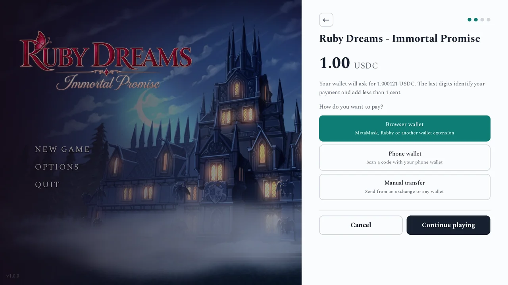

# Stablecoin for Games

Stablecoin for Games (`scfg` in code) lets games take tips and sell unlocks in USDC and USDT on Ethereum,
Arbitrum, Polygon, Base, Arc or Solana. The player's wallet pays the developer's wallet directly. There is no
store, account or server in between. The game watches the blockchain itself and unlocks the item once the
payment is confirmed.



## Engines

| Engine | What you add to your game | Status |
|---|---|---|
| **Ren'Py 8.2+** | the `scfg` plugin (`game/scfg/` and its Python core) | Released, desktop and web builds |
| **Godot 4.3+** | the `addons/scfg/` addon, pure GDScript | Preview: tested on Godot 4.3 and 4.7.2, desktop and web exports |
| **RPG Maker MZ** | one plugin file, `js/plugins/SCFG.js` | Preview: tested on a stand-in for MZ, **not yet in real RPG Maker MZ** |

All three share one payment core, ported from the Ren'Py plugin's Python and checked against the same test
vectors, so they pay, verify and restore the same way. The players' guide below fits all three engines. Mobile
builds are best effort and unverified.

<div className="home-split">
<div>

## Players

- [How paying works](players/paying.md), step by step
- [Which wallets work](players/wallets.md)
- [Restore a purchase](players/restore.md) on a new device

</div>
<div>

## Developers

- **Ren'Py:** [Install](developers/install.md), [Configure](developers/configure/README.md),
  [API reference](developers/use/api-reference.md)
- **Godot:** [Install](developers/godot/install.md), [API reference](developers/godot/api.md),
  [the showcase project](developers/godot/install.md#try-the-showcase-first)
- **RPG Maker MZ:** [Install](developers/rpgmaker/install.md), [API reference](developers/rpgmaker/api.md)
- [Arc](developers/configure/arc.md), where USDC also pays the network fee
- [Security and limitations](developers/security/README.md), for every engine
- [Web builds](developers/security/web-builds.md): Ren'Py's HTML5 build and itch.io (Godot: [Web exports](developers/godot/api.md#web-exports), RPG Maker MZ: [Web deployment](developers/rpgmaker/api.md#web-deployment))

</div>
</div>

## Unlocking a chapter in Ren'Py

```renpy
init python:
    scfg.configure(wallet="0xYourWallet", testnet=True)
    scfg.add_item("chapter2", code=1, price="4.99", token="USDC", title="Chapter 2")

label end_of_chapter1:
    $ result = scfg.pay("unlock", item="chapter2")
    if scfg.owns("chapter2"):
        jump chapter2
```

The same in Godot (see the [Godot install page](developers/godot/install.md)):

```gdscript
Scfg.configure({"wallet": "0xYourWallet", "testnet": true})
Scfg.add_item("chapter2", {"code": 1, "price": "4.99", "token": "USDC", "title": "Chapter 2"})

var result := await Scfg.pay("unlock", {"item": "chapter2"})
if Scfg.owns("chapter2"):
    start_chapter_two()
```

In RPG Maker MZ it is a plugin command, **SCFG > Unlock Item**, with the item set up in the Plugin Manager
(see the [RPG Maker install page](developers/rpgmaker/install.md)).
