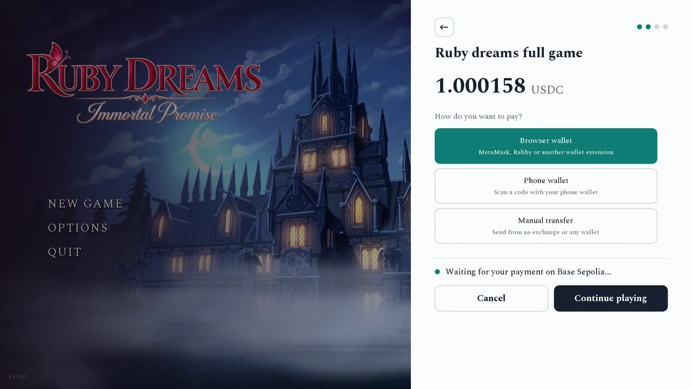

# Stablecoin for Games

Stablecoin for Games (`scfg` in code) is a Ren'Py plugin that lets games take tips and sell unlocks in USDC and
USDT on Ethereum, Arbitrum, Polygon, Base or Solana. The player's wallet pays the
developer's wallet directly. There is no store, account or server in between. The game
watches the blockchain itself and unlocks the item once the payment is confirmed.



<div className="home-split">
<div>

## Players

- [How paying works](players/paying.md), step by step
- [Which wallets work](players/wallets.md)
- [Restore a purchase](players/restore.md) on a new device

</div>
<div>

## Developers

- [Install the plugin](developers/install.md)
- [Configure](developers/configure/README.md) your wallet, networks and paid items
- [API reference](developers/use/api-reference.md) for `pay()`, `owns()` and `restore()`
- [Security and limitations](developers/security/README.md)
- [Web builds](developers/security/web-builds.md) for HTML5 and itch.io

</div>
</div>

## Unlocking a chapter

```renpy
init python:
    scfg.configure(wallet="0xYourWallet", testnet=True)
    scfg.add_item("chapter2", code=1, price="4.99", token="USDC", title="Chapter 2")

label end_of_chapter1:
    $ result = scfg.pay("unlock", item="chapter2")
    if scfg.owns("chapter2"):
        jump chapter2
```
