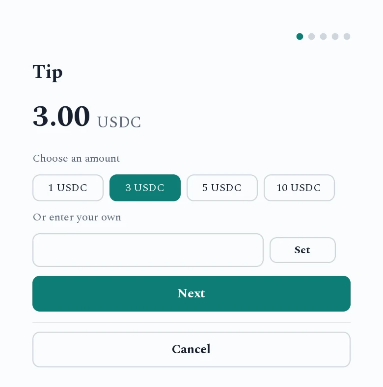
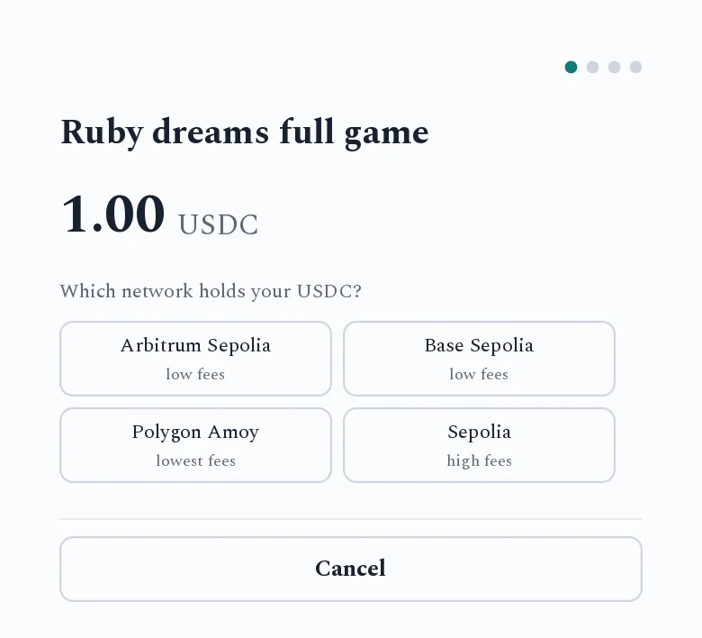
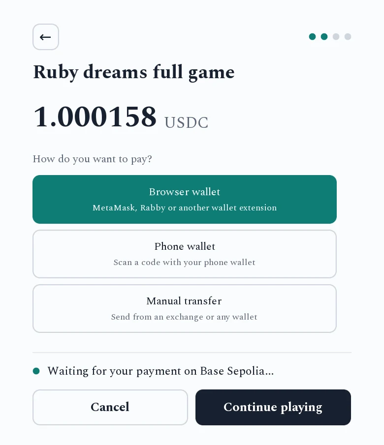
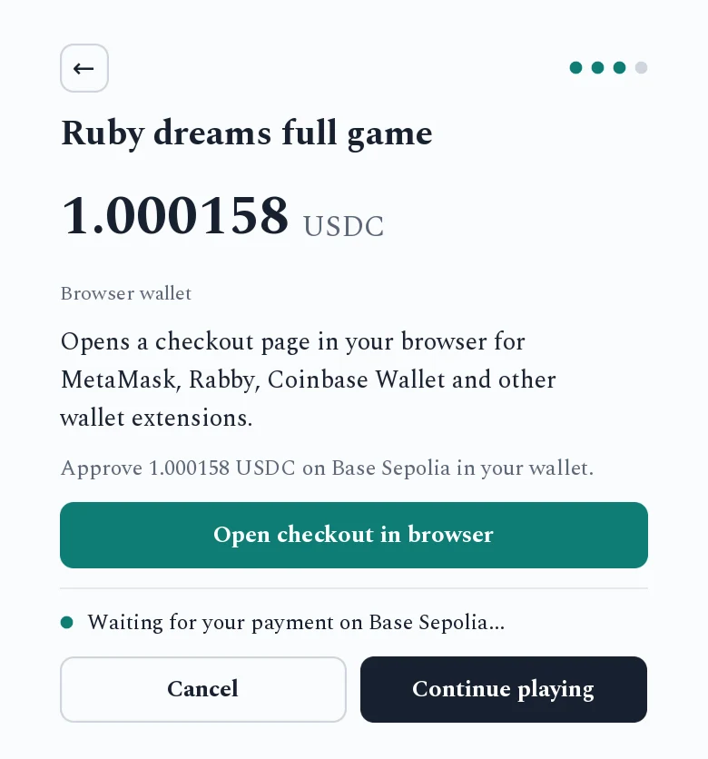
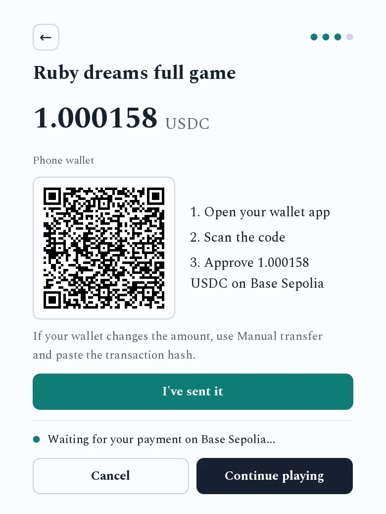
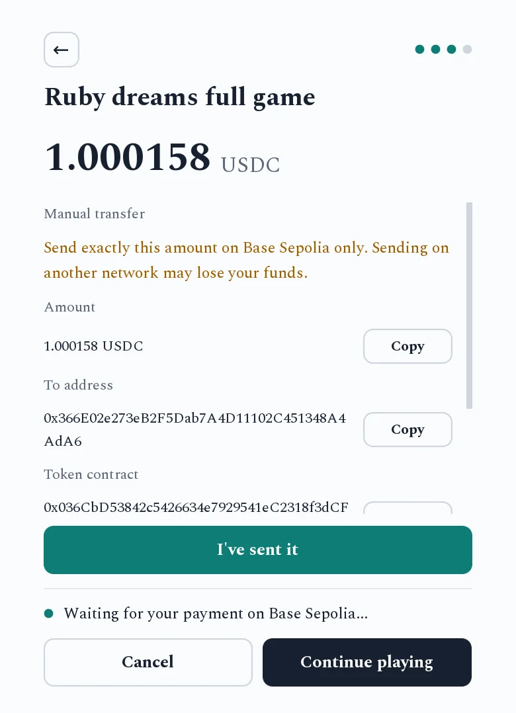
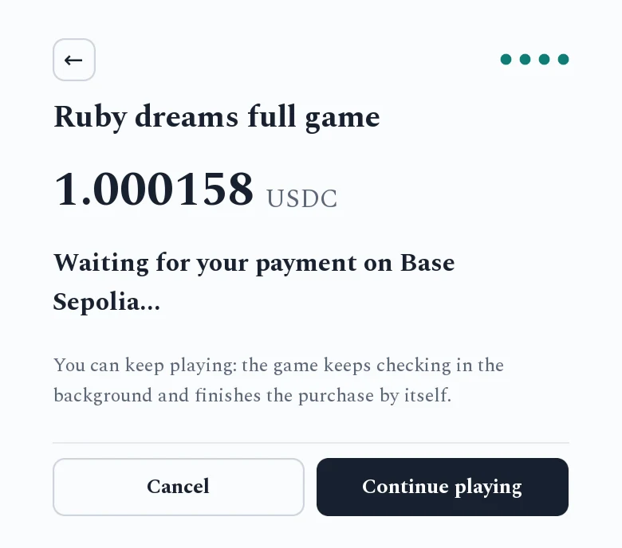
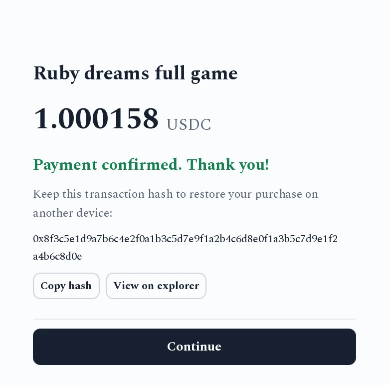

# Paying in a game

When you buy something or leave a tip, a payment sheet slides in on the right of the
game. Your money goes straight to the game's developer. Stablecoin for Games never holds it, and
there is no account to create.

You need USDC or USDT on one of the networks the game offers, plus a little of that
network's own coin for the fee: ETH on Ethereum, Arbitrum and Base, POL on Polygon, SOL on
Solana.

## The steps

The sheet shows one step at a time. Steps with only one choice are skipped. The ← arrow,
Esc or a right-click goes back one step.

The screenshots come from [Ruby Dreams](https://github.com/Repulse-Game-Studio/RubyDreams-Renpy)
on test networks, so the network names end in Sepolia or Amoy. A real game lists
Ethereum, Arbitrum, Polygon, Base or Solana.

### 1. Amount (tips only)

Pick a suggested amount or enter your own, then press **Next**.

### 2. Network

"Which network holds your USDC?" Pick the network your tokens are on. Sending on a
different network than the one you picked can lose your funds.

### 3. Payment method

**Browser wallet** opens a wallet extension such as MetaMask or Phantom. In a downloaded
game this opens a checkout page in your web browser. In a game played in the browser, the
wallet opens right over the game.

**Phone wallet** shows a QR code. Open your wallet app and scan it. On Android, **Open
wallet app** sends the payment to the wallet installed on the phone.

**Manual transfer** shows the amount, the address and the token contract, each with a
**Copy** button. Use it to send from an exchange or a wallet that can't scan codes.

### 4. Approve

Approve the payment in your wallet, or press **I've sent it** after a manual transfer.

### 5. Waiting

The game watches the network for your payment, then waits for it to be confirmed. On
Solana that takes about 15 to 20 seconds. On Ethereum it takes a few minutes.

### 6. Done

"Payment confirmed. Thank you!" The sheet shows your transaction hash (on Solana, the
signature). Copy it and keep it. It is your receipt, and you need it to
[restore the purchase](restore.md) on another device.

## Why the amount has extra digits

A 4.99 USDC item asks for something like **4.993742 USDC**. The last four digits tell
the game which item you bought and which payment is yours. Send that exact amount. The
extra cost is less than a cent.

On Solana the game finds your payment even if your wallet or exchange changes the
amount. On the other networks it may not. Then, on the Manual transfer step, paste the
transaction hash into "Paid from an exchange or another wallet?" and press **Check**. Any amount at or above the price counts.

## You don't have to wait

Press **Continue playing** to close the sheet. The game keeps checking in the background,
even after you quit and restart it, for up to 24 hours. The item unlocks by itself once
the payment is confirmed.

## When something goes wrong

| What you see | What it means |
|---|---|
| "Can't reach the network. Retrying..." | The game can't reach the blockchain right now. It keeps trying. Check your internet connection. |
| "Payment too small" | Less than the price arrived. Contact the developer with your transaction hash. |
| "The payment window has closed" | The game stopped waiting. If you already paid, it keeps checking for 24 hours and unlocks the item when the payment arrives. You can also [restore](restore.md) it with the transaction hash. |
| The checkout page warns that you have no ETH or almost no SOL "for the network fee" | Add a little of that network's coin to your wallet first, or the transaction will fail. |
| You paid on the wrong network | The game can't see it. Contact the developer. They can look up the transaction and refund it or unlock the item by hand. |

The game can't issue refunds. The money is already in the developer's wallet, so refunds
and support requests go to the developer.
