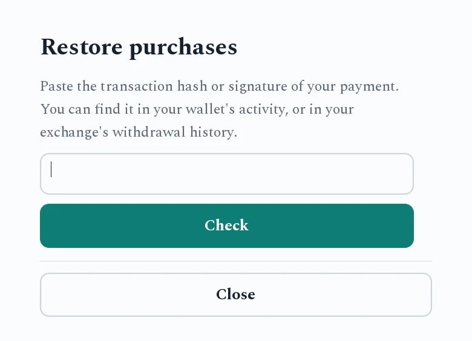

# Restoring purchases

The game stores your purchases on your device. On a new computer or phone, after a
reinstall, or if the purchase didn't show up, you can bring it back from the blockchain.
You only need the transaction hash (on Solana, the signature) of the payment.

1. Open the game's **Restore purchases** screen. Where it lives depends on the game,
   usually the main menu or the preferences.
2. Paste the transaction hash or signature. You can find it in your wallet's activity or
   in your exchange's withdrawal history. In a game played in the browser, **Paste** needs
   the browser's clipboard permission. If you refuse, type the hash instead.
3. Press **Check**. The game looks the payment up and shows what it unlocks.
4. Press **Restore**.

"Nothing new to restore" means those purchases are already on this device.

## If it doesn't work

- **"Transaction not found":** a payment made seconds ago may not be final yet. Wait
  about 15 seconds and try again. For older payments, some public servers don't keep the
  history, so try again later.
- **"What was it for?"** The game can't always tell from the amount what a payment
  bought. Pick the item, or **Keep as a tip**, then press **Restore**.
- Still stuck? Contact the developer with the hash. They can look up the payment and
  unlock the item for you.
