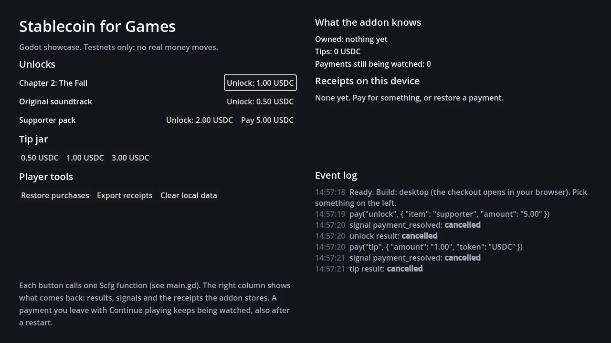

# SCFG Godot showcase

A one-screen Godot 4.3+ project that shows how the Stablecoin for Games addon works. Every button calls
one function of the `Scfg` autoload, and the right-hand column shows what comes back.



| On screen | Calls |
|---|---|
| **Unlocks**: three items, the supporter pack also at a pay-what-you-want amount | `Scfg.pay("unlock", {"item": id})`, `{"item": id, "amount": "5.00"}` |
| **Tip jar**: three suggested amounts | `Scfg.pay("tip", {"amount": "1.00", "token": "USDC"})` |
| **Restore purchases** | `Scfg.restore()` |
| **Export receipts** | `Scfg.export_receipts()` |
| **Clear local data**, a testing helper | `Scfg.clear_local_data()` |
| **What the addon knows** | `Scfg.owns()`, `tip_total()`, `has_tipped()`, `pending()`, `receipts()` |
| **Event log** | every awaited result and the signals `payment_resolved` and `receipts_changed` |

It runs on testnets (Sepolia, Arbitrum Sepolia, Polygon Amoy, Base Sepolia, Arc Testnet), so no real
money moves. The payout wallet is a placeholder that is not yours (the EIP-55 example address); replace
`WALLET` in `main.gd` with your own testnet wallet to watch a real test payment arrive.

## Run it

The addon is not stored in this folder. `tools/sync_demo.py` copies it in from `godot/addons/scfg/`
(the copy is git-ignored).

```
uv run python tools/sync_demo.py --engine godot
godot --path godot/showcase --import     # first run only
godot --path godot/showcase              # or open godot/showcase/project.godot in the editor and press F5
```

To pay for real on a testnet:

1. Put your own wallet address in `WALLET`.
2. Get testnet USDC from [Circle's faucet](https://faucet.circle.com/) into a second wallet (the player's).
3. Press **Unlock**, pick a network and a method:
   - **Browser wallet** opens a checkout page in your browser.
   - **Scan a QR code** suits a phone wallet.
   - **Send it yourself** shows the exact amount and address.
4. The item unlocks once the payment is confirmed on the chain.

Then try **Clear local data** and **Restore purchases** with the transaction hash: the purchase comes back.

## How it is built

`main.gd` reads top to bottom in five sections: configure, build the shop, pay, listen, show the state.
It shows the patterns a real game needs:

- `configure()` and `add_item()` return `null` or the error they already reported, so check them at
  startup.
- The game tree is paused while a sheet is open. The sheet takes focus but does not stop game nodes that
  read input, and the addon keeps running while paused.
- `payment_resolved` can deliver the same result that `await pay()` returns, so its handler only refreshes
  from `Scfg.owns()` instead of counting results.
- If the game quits while a sheet is open, `pay()` and `restore()` return at once, so the code checks that
  the scene is still in the tree before it touches the UI.

`tests/godot_showcase/` boots a copy of the showcase headless in CI. It presses the buttons that need no
chain (export, clear, restore, a tip, each closed with Cancel) and checks the log.

For a smaller example, see [the demo](../demo/README.md): a title screen with one locked chapter. The
end-to-end tests play it against local chains. The full API is in
[the Godot API reference](../../docs/developers/godot/api.md).

The showcase is MIT licensed, like the rest of the repository.
