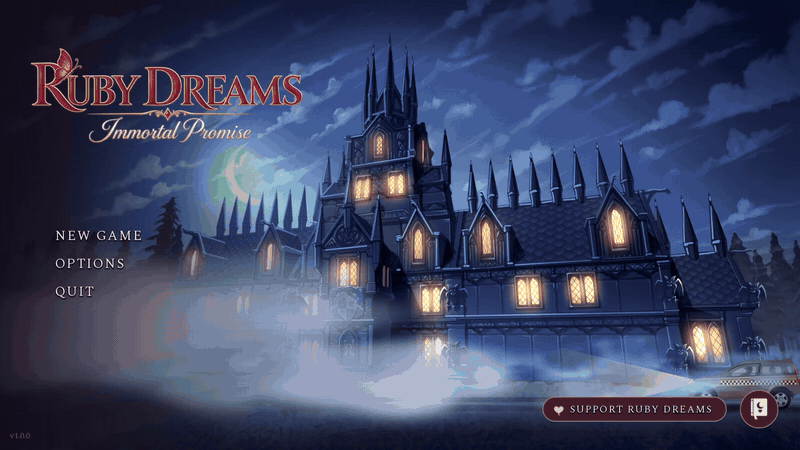

# Stablecoin for Games

Take tips and sell unlocks in **USDC** and **USDT** inside your Ren'Py game, on Ethereum,
Arbitrum, Polygon, Base, Arc or Solana. The player's wallet pays yours directly. There is no
store, account or server in between: the game watches the blockchain itself. Prices are in
dollars. There are no tokens to buy and no NFTs.



This package installs the plugin into your Ren'Py project. It needs Node 18 or newer and
nothing else. The plugin itself is plain Python that runs inside Ren'Py, so the game and
your players never need Node.

## Install

From your Ren'Py project folder (the one that contains `game/`):

```bash
npx scfg-renpy install .
```

That adds:

```
game/scfg/                        (screens, API, browser checkout page)
game/python-packages/scfg_core/   (the engine; plain Python)
```

## Update

```bash
npx scfg-renpy@latest update .
```

It replaces those two folders with the latest version. Your own files, your configuration
and your players' purchases are not touched.

## Use it

```renpy
init python:
    scfg.configure(wallet="0xYourWallet", testnet=True)
    scfg.add_item("chapter2", code=1, price="4.99", token="USDC", title="Chapter 2")

label end_of_chapter1:
    $ result = scfg.pay("unlock", item="chapter2")
    if scfg.owns("chapter2"):
        jump chapter2
```

Requires Ren'Py 8.2 or newer. Read the
[developer guide](https://jrpg.com/stablecoinforgames/docs/developers/install) and the
[security notes](https://jrpg.com/stablecoinforgames/docs/developers/security) before you
sell anything: without a server, unlocks are honour-grade.

- Docs: https://jrpg.com/stablecoinforgames/docs/
- Source and release zips: https://github.com/Repulse-Game-Studio/jrpg-stablecoin-games
- Also on PyPI: `uvx scfg-renpy install .`
- License: MIT
